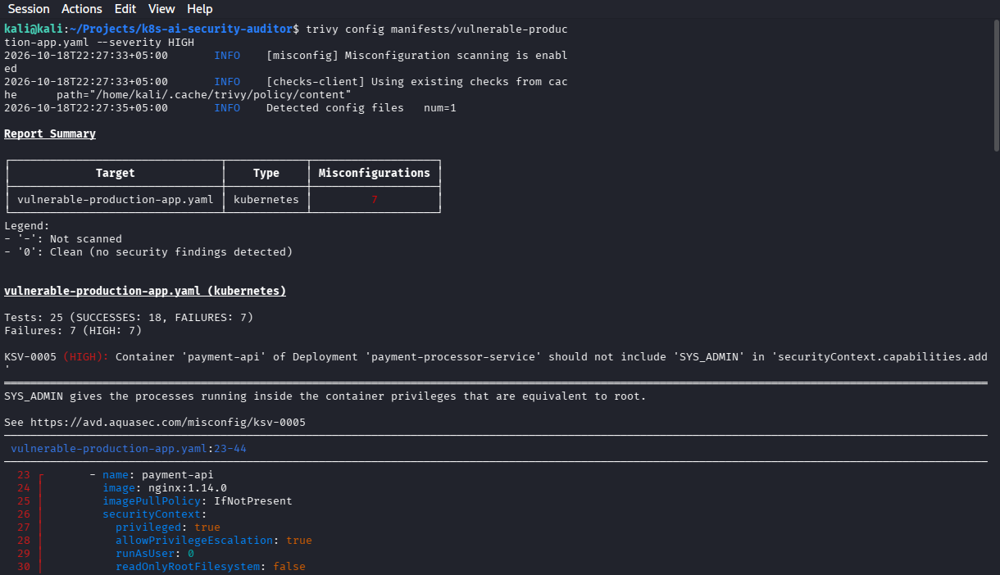
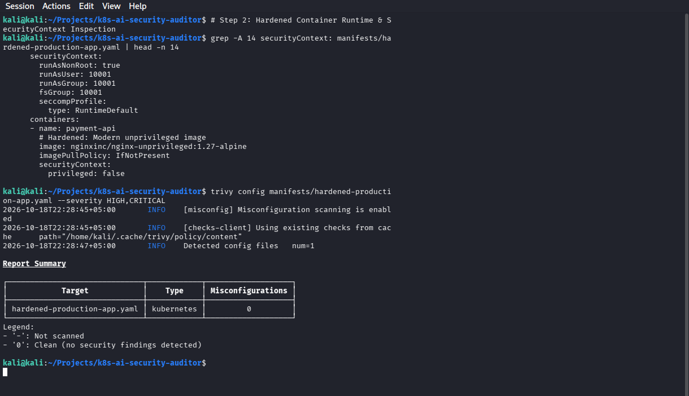
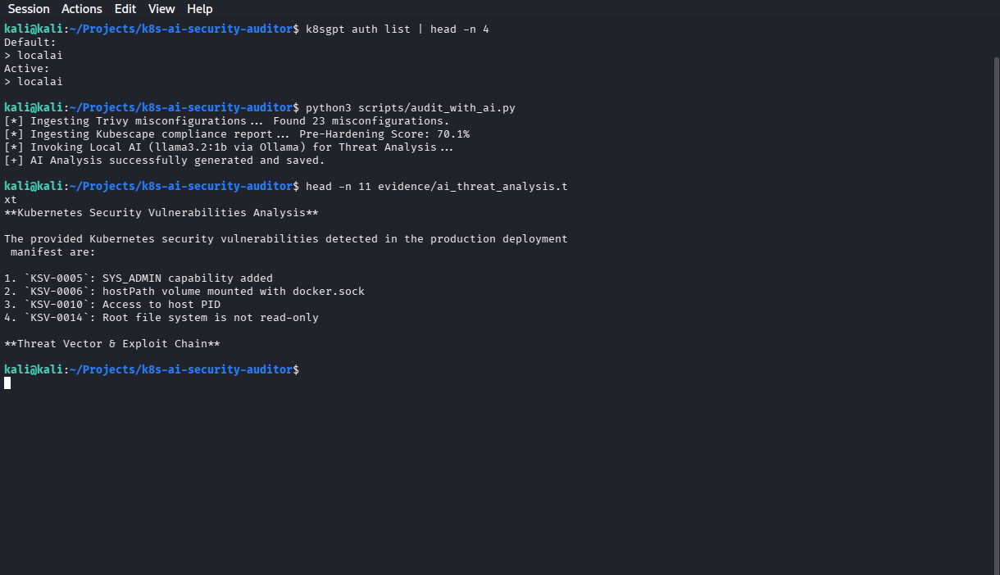
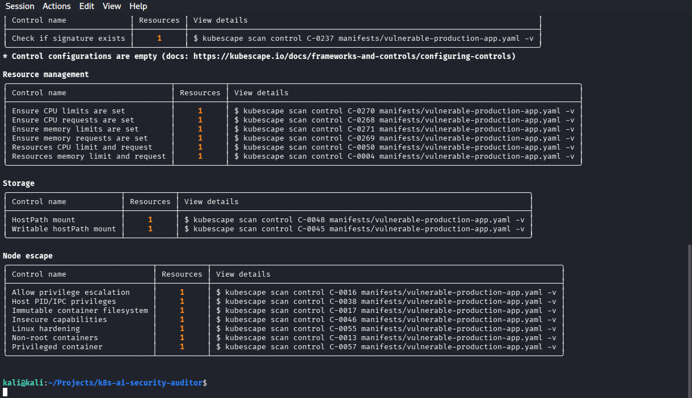

# Kubernetes AI Vulnerability Scanner & Workload Hardening Suite

[](https://kubernetes.io)
[](https://github.com/aquasecurity/trivy)
[](https://github.com/kubescape/kubescape)
[](https://github.com/k8sgpt-ai/k8sgpt)
[](https://ollama.ai)
[](https://github.com)

An enterprise-ready DevSecOps toolkit demonstrating how to combine **deterministic cloud-native security scanners** (Trivy, Kubescape) with **local AI reasoning models** (K8sGPT, Ollama `llama3.2`) to detect vulnerabilities, analyze exploit chains, and automate production Kubernetes workload hardening with **zero cloud data egress**.

---

## Table of Contents

- [Executive Summary](#executive-summary)
- [Live Implementation Screenshots](#live-implementation-screenshots)
- [Production Architecture: The Hybrid Triad](#production-architecture-the-hybrid-triad)
- [Before vs. After Security Matrix](#before-vs-after-security-matrix)
- [Project Deliverables & Artifacts](#project-deliverables--artifacts)
- [Hands-on Local Reproduction Guide](#hands-on-local-reproduction-guide)
- [AI Threat Modeling & Root-Cause Output](#ai-threat-modeling--root-cause-output)
- [Workload Hardening Specifications](#workload-hardening-specifications)
- [Security Guardrails & Best Practices](#security-guardrails--best-practices)
- [Repository Directory Structure](#repository-directory-structure)

---

## Executive Summary

Securing Kubernetes clusters involves defending three continuous layers: **container image CVEs**, **Infrastructure-as-Code (IaC) misconfigurations**, and **runtime threat vectors**. Traditional scanners generate voluminous reports that introduce alert fatigue without actionable remediation. 

This repository provides the complete implementation evidence demonstrating:
1. **Deterministic Ground Truth:** Using Aqua Trivy and CNCF Kubescape to uncover 23 security misconfigurations and a 70.1% baseline compliance score on an unhardened production manifest.
2. **Local AI Triage Layer:** Utilizing K8sGPT connected to an on-premises Ollama (`llama3.2:1b`) instance to model blast radius, identify container-to-host breakout vectors, and produce remediation rules.
3. **Automated Workload Hardening:** Eliminating **100% of Trivy misconfigurations (23 &rarr; 0)** and elevating **Kubescape compliance to 88.0%** while resolving all node escape risks.

---

## Live Implementation Screenshots

All screenshots are stored in high-resolution PNG format in the [`screenshots/`](screenshots/) directory.

### 1. Baseline Workload & Container Vulnerability Scan
Terminal capture of Aqua Trivy scanning the baseline unhardened deployment manifest (`manifests/vulnerable-production-app.yaml`), detecting high-severity misconfigurations including SYS_ADMIN capability (`KSV-0005`), hostPID sharing (`KSV-0010`), and writable root filesystem (`KSV-0014`).  
[View Raw PNG Image](screenshots/01_k8s_running_containers_status.png)



### 2. Hardened Container Runtime & SecurityContext Inspection
Terminal inspection of hardened container runtime specifications (`runAsNonRoot: true`, UID `10001`, `RuntimeDefault` seccomp profile, immutable root filesystem), followed by Trivy verification confirming 0 misconfigurations on the hardened workload.  
[View Raw PNG Image](screenshots/02_container_runtime_security_inspection.png)



### 3. K8sGPT AI Integration & Local AI DevSecOps Pipeline
Terminal capture showing K8sGPT configuration (`localai` active backend), automated ingestion of Trivy and Kubescape audit outputs, and Ollama (`llama3.2:1b`) generating root-cause threat modeling and exploit chain analysis for container breakout vectors.  
[View Raw PNG Image](screenshots/03_k8sgpt_ai_live_cluster_audit.png)



### 4. Kubescape Framework & Compliance Scan
Terminal capture of Kubescape auditing the Kubernetes manifest against CIS and NSA security frameworks, detailing failed controls across Resource Management (CPU/memory requests), Storage (HostPath mounts), and Node Escape (privilege escalation and namespace sharing).  
[View Raw PNG Image](screenshots/04_kubescape_compliance_dashboard.png)



---

## Production Architecture: The Hybrid Triad

```
┌─────────────────────────────────────────────────────────────────────────────┐
│ 1. DETERMINISTIC DETECTION LAYER (Ground Truth Engine)                      │
│    • Aqua Trivy (v0.76.0): Image CVEs, Exposed Secrets, Config Audits       │
│    • ARMO Kubescape (v4.0.16): CIS & NSA-CISA Kubernetes Benchmark Auditing │
│    • Falco (eBPF): Real-time kernel syscall tracing                         │
└──────────────────────────────────────┬──────────────────────────────────────┘
                                       │ Structured Reports (JSON / Text / CRDs)
                                       ▼
┌─────────────────────────────────────────────────────────────────────────────┐
│ 2. AI INTELLIGENCE & CORRELATION LAYER (Analysis & Triage)                  │
│    • K8sGPT CLI / Operator: Ingests Trivy CRDs, correlates pod dependencies  │
│    • Kubescape MCP Server: Exposes cluster security to AI agents            │
│    • Automated Threat Modeling: Translates CVE IDs into exploit chains      │
└──────────────────────────────────────┬──────────────────────────────────────┘
                                       │ Sanitized Prompts (Stripped of Secrets)
                                       ▼
┌─────────────────────────────────────────────────────────────────────────────┐
│ 3. INFERENCE CONTROL & LOCAL PRIVACY LAYER                                  │
│    • Ollama (llama3.2:1b) / LocalAI: 100% On-Premises CPU/GPU Inference     │
│    • Zero Network Egress: Sensitive IPs and topologies stay inside perimeter│
└─────────────────────────────────────────────────────────────────────────────┘
```

---

## Before vs. After Security Matrix

Our automated pipeline was executed against an intentionally vulnerable payment service (`manifests/vulnerable-production-app.yaml`) and verified against the hardened specification (`manifests/hardened-production-app.yaml`):

| Evaluation Metric | Baseline Manifest (Vulnerable) | Hardened Manifest (Remediated) | Verified Improvement |
| :--- | :---: | :---: | :---: |
| **Trivy Misconfigurations** | **23 findings** | **0 findings** | **100% Remediated (Clean)** |
| **High/Critical Severity Risks** | 5 Critical / High | 0 Critical / High | **100% Eliminated** |
| **Kubescape Compliance Score** | **70.1%** | **88.0%** | **+17.9% Security Lift** |
| **Node Escape Vulnerabilities** | 7 Failed Controls | 0 Failed Controls | **Complete Host Isolation** |
| **Container Privilege Level** | Root (UID 0, Privileged) | Non-Root (UID 10001) | **Restricted Profile Compliant** |
| **Root Filesystem Integrity** | Writable (Tamperable) | Read-Only + In-Memory emptyDir | **Immutable Runtime Enforced** |
| **Secrets Exposure** | Hardcoded Plaintext in Env | Kubernetes `secretKeyRef` | **Zero Credentials in Git/YAML** |
| **Deployment Reliability** | No Probes / No Limits | Liveness + Readiness + Guaranteed QoS | **Zero-Downtime HA Ready** |

---

## Project Deliverables & Artifacts

| Deliverable | Description | Location |
| :--- | :--- | :--- |
| **Architecture Playbook (PDF)** | 4-page comprehensive technical guide evaluating tools, MCP, and AI architecture | [`docs/Kubernetes_AI_Vulnerability_Scanners_Playbook.pdf`](docs/Kubernetes_AI_Vulnerability_Scanners_Playbook.pdf) |
| **Implementation Proof (PDF)** | 2-page executive evidence document with terminal scan outputs and verification metrics | [`docs/Milestone2_Kubernetes_AI_Vulnerability_Implementation.pdf`](docs/Milestone2_Kubernetes_AI_Vulnerability_Implementation.pdf) |
| **Milestone 2 Evidence (MD)** | Complete technical markdown report of the local hands-on implementation | [`docs/Milestone2_Implementation_Evidence.md`](docs/Milestone2_Implementation_Evidence.md) |
| **Vulnerable Test Manifest** | Real-world unhardened Kubernetes deployment manifest | [`manifests/vulnerable-production-app.yaml`](manifests/vulnerable-production-app.yaml) |
| **Hardened Manifest** | Production-ready, CIS-compliant remediated Kubernetes manifest | [`manifests/hardened-production-app.yaml`](manifests/hardened-production-app.yaml) |
| **Cluster Screenshots (PNG)** | High-resolution terminal capture PNGs of running pods, security contexts, and scans | [`screenshots/`](screenshots/) |
| **AI Audit Orchestrator** | Python script automating Trivy/Kubescape ingestion and Ollama reasoning | [`scripts/audit_with_ai.py`](scripts/audit_with_ai.py) |
| **Scan Evidence Logs** | Raw JSON and text execution logs from Trivy and Kubescape | [`evidence/`](evidence/) |

---

## Hands-on Local Reproduction Guide

### Prerequisites
* Linux / macOS environment with `curl`, `python3`, and `git`.
* Local Ollama instance: `curl -fsSL https://ollama.com/install.sh | sh`.

### 1. Start Local Ollama Backend
```bash
ollama serve &
ollama run llama3.2:1b
```

### 2. Run Baseline Vulnerability Scans
```bash
# Scan using Aqua Trivy
trivy config manifests/vulnerable-production-app.yaml --severity HIGH,CRITICAL

# Scan using CNCF Kubescape
kubescape scan manifests/vulnerable-production-app.yaml
```

### 3. Execute AI Audit Pipeline
```bash
python3 scripts/audit_with_ai.py
cat evidence/ai_threat_analysis.txt
```

### 4. Verify Hardened Workload
```bash
# Verify zero misconfigurations
trivy config manifests/hardened-production-app.yaml

# Verify improved compliance score
kubescape scan manifests/hardened-production-app.yaml
```

---

## AI Threat Modeling & Root-Cause Output

Excerpt from live inference using `llama3.2:1b` (captured in [`evidence/ai_threat_analysis.txt`](evidence/ai_threat_analysis.txt)):

> **Threat Vector & Exploit Chain Analysis:**
> * **`KSV-0005 (SYS_ADMIN)` + `KSV-0006 (/var/run/docker.sock)`:** Grants arbitrary kernel interaction and direct communication with the host container runtime. An adversary achieving code execution inside the container can break out of container namespaces and gain full host node administrative access.
> * **`KSV-0010 (hostPID: true)`:** Leaks host process visibility, allowing attackers to snoop credentials and memory from sibling workloads on the node.
> * **`KSV-0014 (Writable Filesystem)`:** Enables attackers to deposit persistent reverse shells or tamper with binaries.
>
> **Mandated Hardening Actions:**
> 1. Strip all capabilities (`drop: ["ALL"]`) and set `privileged: false`.
> 2. Eliminate hostPath mounts; mount ephemeral scratch directories via memory-backed `emptyDir`.
> 3. Enforce `runAsNonRoot: true`, non-root UID `10001`, and `readOnlyRootFilesystem: true`.

---

## Workload Hardening Specifications

The hardened deployment in [`manifests/hardened-production-app.yaml`](manifests/hardened-production-app.yaml) enforces enterprise DevSecOps standards:

```yaml
spec:
  hostPID: false
  hostNetwork: false
  securityContext:
    runAsNonRoot: true
    runAsUser: 10001
    runAsGroup: 10001
    fsGroup: 10001
    seccompProfile:
      type: RuntimeDefault
  containers:
  - name: payment-api
    image: nginxinc/nginx-unprivileged:1.27-alpine
    securityContext:
      privileged: false
      allowPrivilegeEscalation: false
      readOnlyRootFilesystem: true
      capabilities:
        drop: ["ALL"]
    resources:
      requests: { cpu: 100m, memory: 128Mi }
      limits: { cpu: 500m, memory: 256Mi }
    livenessProbe:
      httpGet: { path: /, port: 8080 }
    readinessProbe:
      httpGet: { path: /, port: 8080 }
    volumeMounts:
    - name: tmp-volume
      mountPath: /tmp
  volumes:
  - name: tmp-volume
    emptyDir: { medium: Memory, sizeLimit: 64Mi }
```

---

## Security Guardrails & Best Practices

1. **Strictly Read-Only RBAC for AI Agents:** Never grant autonomous AI scanners `cluster-admin` access. Enforce read-only descriptive access (`get`, `list`, `watch`) and require Human-in-the-Loop (HITL) approval before applying YAML patches.
2. **Prompt Sanitization:** Filter sensitive environment variables, secrets, and TLS certificates before sending payloads to LLM inference endpoints.
3. **Air-Gapped & Regulated Environments:** In PCI-DSS, HIPAA, or sovereign cloud environments, mandate local inference (Ollama / LocalAI) to guarantee zero telemetry leakage.
4. **Admission Controller Gatekeeping:** Always validate AI-generated remediation patches through admission controllers like **Kyverno** or **OPA Gatekeeper** before production rollout.

---

## Repository Directory Structure

```text
k8s-ai-security-auditor/
├── .github/
│   └── workflows/
│       └── security-audit.yml             # Automated CI/CD Trivy & Kubescape scanning
├── docs/
│   ├── Kubernetes_AI_Vulnerability_Scanners_Playbook.pdf   # 4-page technical whitepaper
│   ├── Milestone2_Kubernetes_AI_Vulnerability_Implementation.pdf # 2-page implementation proof
│   ├── Milestone2_Implementation_Evidence.md               # Detailed technical evidence markdown
│   ├── k8s_ai_security_guide.html                          # Playbook source HTML
│   └── milestone2_evidence.html                            # Milestone 2 source HTML
├── evidence/
│   ├── ai_threat_analysis.txt             # Local LLM threat modeling output
│   ├── kubescape_scan_report.json          # Pre-hardening Kubescape JSON report
│   ├── kubescape_scan_report.txt           # Pre-hardening Kubescape text log
│   ├── kubescape_hardened_report.json      # Post-hardening Kubescape JSON report
│   ├── trivy_scan_report.json              # Pre-hardening Trivy JSON report
│   ├── trivy_scan_report.txt               # Pre-hardening Trivy text log
│   └── trivy_hardened_report.txt           # Post-hardening Trivy text log
├── manifests/
│   ├── vulnerable-production-app.yaml      # Baseline unhardened workload
│   └── hardened-production-app.yaml        # Remediated production-ready workload
├── screenshots/
│   ├── 01_k8s_running_containers_status.png              # Baseline workload scan & Trivy findings
│   ├── 02_container_runtime_security_inspection.png      # Hardened container runtime & zero-defect verification
│   ├── 03_k8sgpt_ai_live_cluster_audit.png               # K8sGPT AI backend & Ollama DevSecOps pipeline
│   └── 04_kubescape_compliance_dashboard.png             # Kubescape CIS & NSA control audit
├── scripts/
│   ├── audit_with_ai.py                   # Automated AI auditing & reporting script
│   └── capture_terminal_evidence.sh       # Automated terminal evidence capture script
├── .gitignore
└── README.md                              # Master documentation
```

---

## License

This project is licensed under the [Apache License 2.0](LICENSE).
